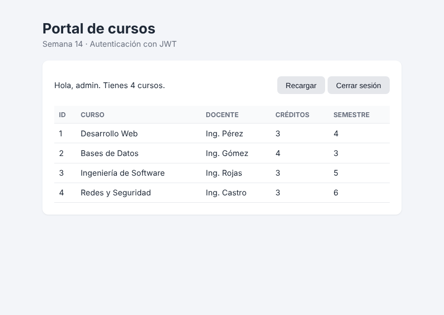
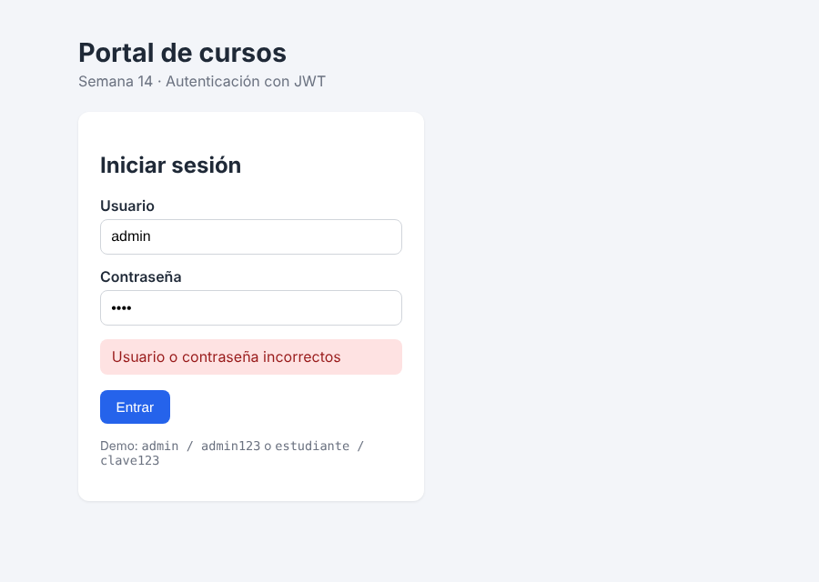

# Semana 14 · Seguridad con JWT, pruebas y Docker

**Estudiante:** Andres Felipe Cardenas Bermeo (`@felip442`)
**Curso:** Complementaria III · Profundización Desarrollo Fullstack · 2026-B · CORHUILA

Aplicación fullstack con:

- **Backend:** API REST en Node.js + Express, protegida con **JWT** (`jsonwebtoken`) y con **CORS** configurado.
- **Frontend:** HTML + CSS + JavaScript (módulos ES) con **login** y una **vista de datos** protegida.
- **Pruebas:** backend y frontend con el runner nativo de Node (`node:test`), incluyendo casos de error.
- **Docker:** un `Dockerfile` por servicio y `docker-compose.yml` para correr todo en contenedores.



## Estructura

```
semana_14/
├── backend/
│   ├── src/
│   │   ├── app.js              # Express + CORS + rutas
│   │   ├── server.js           # Arranque del servidor
│   │   ├── config.js           # Variables de entorno (JWT_SECRET, CORS_ORIGIN…)
│   │   ├── users.js            # Usuarios demo con contraseña hasheada (scrypt)
│   │   ├── middleware/auth.js  # Verifica el JWT (Authorization: Bearer)
│   │   └── routes/
│   │       ├── auth.js         # POST /api/auth/login, GET /api/auth/me
│   │       └── cursos.js       # GET /api/cursos (protegido)
│   ├── tests/api.test.js       # 12 pruebas del backend
│   ├── Dockerfile
│   └── package.json
├── frontend/
│   ├── public/
│   │   ├── index.html          # Login + vista de datos
│   │   ├── css/styles.css
│   │   └── js/
│   │       ├── api.js          # Cliente de la API (login, token, getCursos)
│   │       └── app.js          # Lógica de la interfaz (DOM)
│   ├── tests/api.test.js       # 8 pruebas del frontend
│   ├── server.js               # Servidor estático sin dependencias
│   ├── Dockerfile
│   └── package.json
├── docs/                       # Capturas
├── docker-compose.yml
└── .env.example
```

## Endpoints

| Método | Ruta | Protegido | Descripción | Errores |
| --- | --- | --- | --- | --- |
| GET | `/api/health` | No | Estado de la API | — |
| POST | `/api/auth/login` | No | Recibe `{ username, password }` y devuelve `{ token, user }` | 400 campos vacíos · 401 credenciales malas |
| GET | `/api/auth/me` | Sí | Usuario dueño del token | 401 / 403 |
| GET | `/api/cursos` | Sí | Lista de cursos | 401 sin token · 403 token inválido o expirado |
| GET | `/api/cursos/:id` | Sí | Un curso | 404 no existe |

**Usuarios de prueba:** `admin / admin123` y `estudiante / clave123`.

Ejemplo con `curl`:

```bash
TOKEN=$(curl -s -X POST http://localhost:3000/api/auth/login \
  -H "Content-Type: application/json" \
  -d '{"username":"admin","password":"admin123"}' | node -pe "JSON.parse(require('fs').readFileSync(0)).token")

curl http://localhost:3000/api/cursos -H "Authorization: Bearer $TOKEN"
```

## Cómo ejecutar (sin Docker)

Requisito: Node.js 20 o superior.

```bash
# Terminal 1 - backend
cd backend
npm install
npm start            # http://localhost:3000

# Terminal 2 - frontend
cd frontend
npm start            # http://localhost:8080
```

Abrir <http://localhost:8080> e iniciar sesión.

## Pruebas

```bash
cd backend && npm test     # 12 pruebas (login, token, rutas protegidas, CORS)
cd frontend && npm test    # 8 pruebas (cliente de la API con fetch simulado)
```

Casos de error cubiertos:

- **Backend:** contraseña incorrecta (401), campos vacíos (400), JSON mal formado (400), sin token (401), token falso (403), token firmado con otro secreto (403), token expirado (403) y origen no permitido por CORS.
- **Frontend:** credenciales incorrectas (muestra el mensaje y no guarda token), campos vacíos (no llama a la API), servidor caído o bloqueado por CORS, sin token, y token expirado (borra la sesión).



## Cómo ejecutar con Docker

```bash
cp .env.example .env          # opcional: cambia JWT_SECRET
docker compose up --build     # API en :3000 y frontend en :8080
```

Correr las pruebas dentro de los contenedores:

```bash
docker compose run --rm api npm test
docker compose run --rm web npm test
```

Solo el backend con `docker run`:

```bash
docker build -t semana14-api ./backend
docker run -p 3000:3000 -e JWT_SECRET=mi-secreto semana14-api
```

Detener todo: `docker compose down`.

## Security & run

The application uses JSON Web Tokens (JWT) for stateless authentication. When the user submits the login form, the frontend sends the username and password to `POST /api/auth/login`, and the backend compares the password against a salted scrypt hash instead of plain text. If the credentials are valid, the API signs a JWT with the HS256 algorithm, a secret read from the `JWT_SECRET` environment variable and an expiration time of one hour. The frontend stores the token and sends it in the `Authorization: Bearer <token>` header on every request to protected endpoints such as `GET /api/cursos`. A middleware verifies the signature and the expiration date, so a request without a token returns 401 and a forged or expired token returns 403. CORS is restricted to the frontend origin (`http://localhost:8080`), so other websites cannot read the API responses from a browser. The backend tests use Node's built-in test runner to check a successful login, wrong passwords, missing fields, missing, forged and expired tokens, and the CORS headers. The frontend tests mock `fetch` and `localStorage` to check that the token is saved, sent in the header and removed when the server rejects it, including the error messages shown to the user. To run everything with Docker, copy `.env.example` to `.env`, run `docker compose up --build`, and open `http://localhost:8080` in the browser. The tests can also be executed inside the containers with `docker compose run --rm api npm test` and `docker compose run --rm web npm test`.

## Decisiones y limitaciones

- Los usuarios están en memoria (no hay base de datos) para mantener el foco en JWT.
- El token se guarda en `localStorage` por simplicidad; en producción conviene una cookie `HttpOnly` para reducir el riesgo de XSS.
- El secreto por defecto es solo para desarrollo: en producción siempre se define `JWT_SECRET`.
